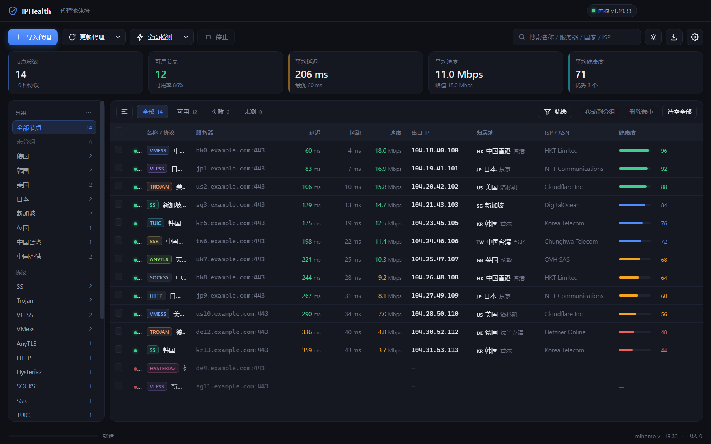
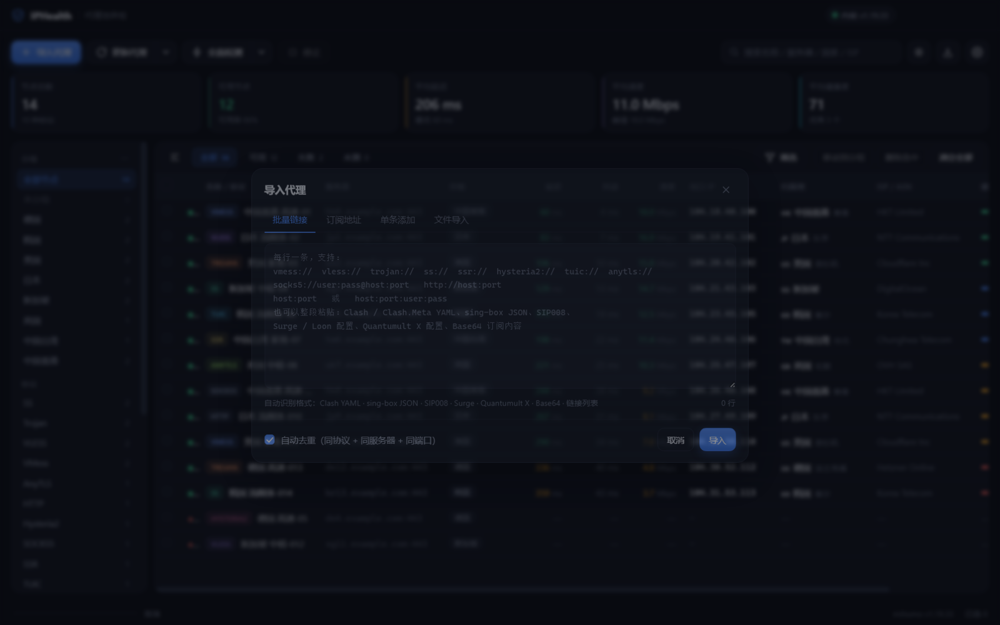
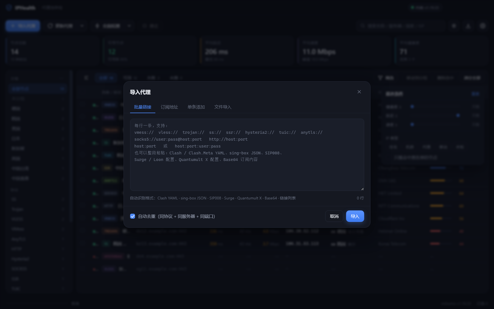
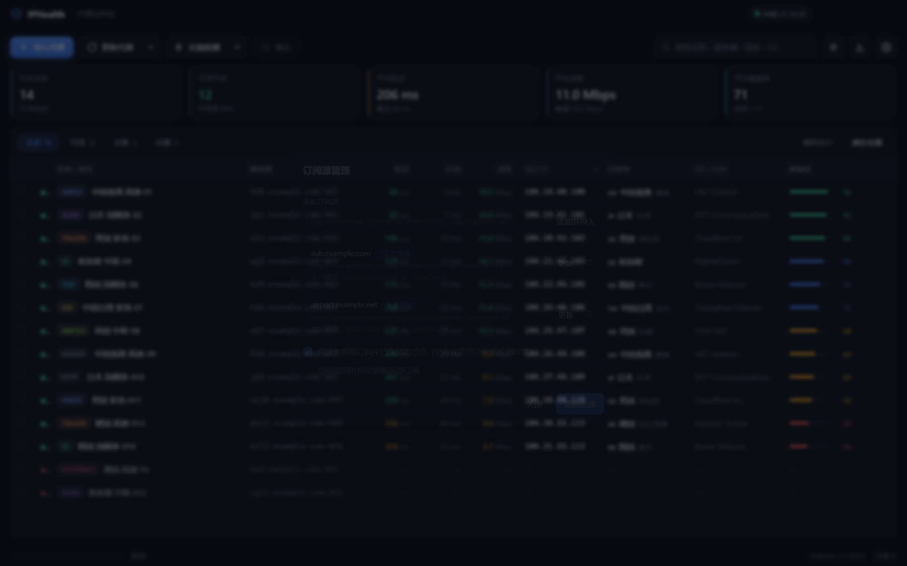
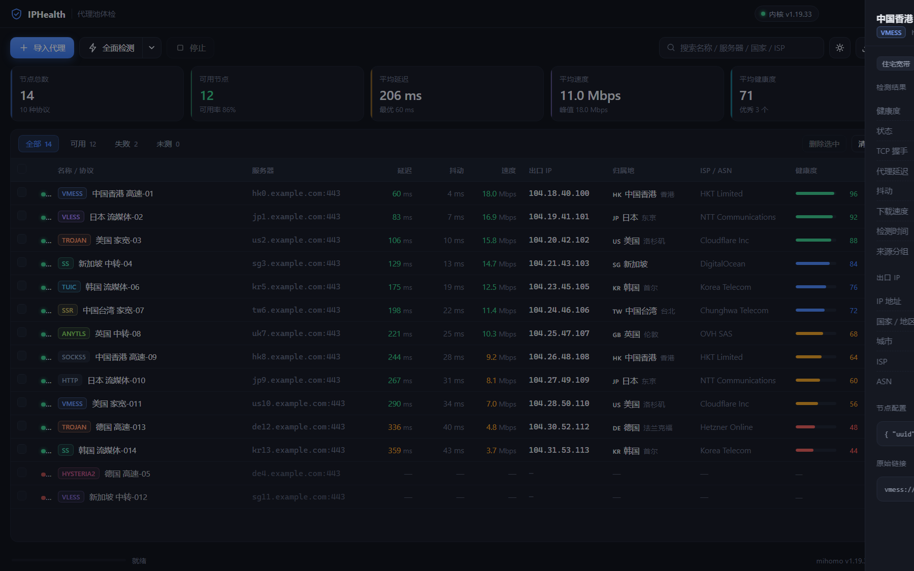

# IPHealth · 代理池 IP 健康度检测工具

一个 Windows x64 桌面工具：**导入代理 / 代理链接 → 批量测速、测延迟、测 IP 健康度、查 IP 归属地**。

界面基于 Electron，代理协议由内置的 [mihomo](https://github.com/MetaCubeX/mihomo)（Clash.Meta）内核驱动，
每个节点自动分配一个本地监听端口，检测请求真实经过该节点发出，结果可复现。



<details>
<summary>导入面板 / 筛选面板 / 订阅源管理 / 节点详情</summary>









</details>

---

## 功能

| 模块 | 说明 |
| --- | --- |
| 多格式导入 | 单条添加、批量链接、订阅地址、文件导入（拖入 .txt/.yaml/.json/.conf） |
| 更新代理 | 订阅源管理与一键同步：新增节点、更新配置、移除失效节点，保留已测结果 |
| 分组管理 | 按来源/地区/协议自动分组，支持重命名、批量移动、导出分组、删除分组（保留节点） |
| 筛选过滤 | 左侧分面筛选（分组 / 协议 / 地区）+ 高级过滤（健康度、延迟、速度、IP 类型、黑名单） |
| 多协议支持 | VMess / VLESS / Trojan / Shadowsocks / SSR / Hysteria / Hysteria2 / TUIC / AnyTLS / SOCKS5 / HTTP / WireGuard |
| 延迟检测 | 先预热再 3 次采样，输出平均延迟与抖动；同时给出 TCP 握手延迟 |
| 测速 | 通过节点真实下载指定数据量，换算 Mbps（测速源可切换） |
| IP 归属地 | 出口 IP、国家/地区/城市、ISP、ASN、IP 类型（住宅 / 机房 / 移动 / 代理） |
| IP 健康度 | 0–100 分综合评分，含 DNSBL 黑名单查询、代理特征识别 |
| 结果管理 | 排序、筛选、搜索、多选删除、详情抽屉（含健康度扣分依据）、CSV / JSON / TXT 导出 |
| 并发调度 | 可配置并发数与超时，实时进度与逐条结果回填，可随时停止 |
| 容错 | 单个节点配置非法时二分定位并剔除，不影响整批检测 |
| 界面 | 明暗双主题（工具栏太阳图标切换），设置与节点列表本地持久化 |

## 支持的导入格式

工具会自动识别内容格式，无需手动选择：

- **代理链接**：`vmess://` `vless://` `trojan://` `ss://` `ssr://` `hysteria://` `hysteria2://` `hy2://` `tuic://` `anytls://` `socks5://` `socks://` `http://` `https://`
- **纯文本代理**：`host:port`、`host:port:user:pass`、`user:pass@host:port`
- **Clash / Clash.Meta 配置**：`proxies:` YAML（支持 ws-opts / grpc-opts / reality / plugin 等嵌套字段）
- **sing-box 配置**：`outbounds:` JSON
- **SIP008**：Shadowsocks 官方订阅 JSON（`servers:`）
- **Surge / Loon / Shadowrocket**：`名称 = ss, host, port, encrypt-method=..., password=...`
- **Quantumult X**：`shadowsocks=host:port, method=..., password=..., tag=...`
- **Base64 订阅**：整段 Base64（自动解码，支持多层）
- **订阅链接**：自动携带 Clash 客户端 UA，兼容 Clash / V2Ray / 通用 Base64 订阅

> 若 Clash 配置里只有 `proxy-providers`（远程 provider），工具会提示改用 provider 的订阅链接导入。

## 更新代理（订阅同步）

工具栏「更新代理」按钮可直接同步全部订阅源；下拉菜单支持「更新全部订阅源 / 更新选中节点所在订阅 / 管理订阅源…」。

同步规则：

| 情况 | 处理 |
| --- | --- |
| 订阅中新增的节点 | 追加到列表，状态为未检测 |
| 已存在的节点（协议 + 服务器 + 端口一致） | 仅更新配置与名称，**保留延迟/速度/IP/健康度结果** |
| 订阅中已消失的节点 | 默认移除（可在订阅源管理中关闭），同时清理其选中状态 |
| 其它订阅源已有的同节点 | 跳过，避免重复 |

订阅源会持久化保存（URL、节点数、上次更新时间、识别格式、错误信息），
可在「管理订阅源」中添加/单独更新/移除（移除订阅源不会删除已导入的节点），
也支持「启动应用时自动更新全部订阅」。

## 分组与筛选

### 分组

左侧栏「分组」区域按节点实际分组实时统计，支持：

- **新建分组**：选中节点后「移动到分组 → 新建分组…」，或分组菜单里的「新建分组」
- **重命名 / 删除**：鼠标悬停分组行右侧「⋯」→ 重命名、删除（只解除分组，不删节点）
- **批量移动**：勾选节点 → 表格右上「移动到分组」→ 选目标分组
- **自动分组**：分组菜单里「按地区自动分组」「按协议自动分组」，一键整理
- **导出分组**：右键分组 → 导出该分组链接为 txt

> 分组是节点的属性，不是独立的空容器：没有节点的分组不会保留。

### 筛选

左侧栏是分面筛选，点击即生效，同一维度多选是「或」，不同维度之间是「且」：

| 维度 | 说明 |
| --- | --- |
| 分组 | 全部 / 未分组 / 具体分组（单选） |
| 协议 | VMess、VLESS、Trojan、SS… 可多选 |
| 地区 | 按国家码，可多选，数量多时可展开全部 |
| 状态 | 全部 / 可用 / 失败 / 未测（顶部 chip） |

表格右上「筛选」面板提供数值与特征过滤：

- 健康度 ≥ N、延迟 ≤ N ms、速度 ≥ N Mbps
- IP 类型（住宅 / 机房 / 代理 / 移动 / 未知）
- 只看命中黑名单的节点

已生效的条件会以 chips 显示在表格上方，可单条移除或「清除全部」；侧栏数量会随其它筛选条件实时联动（分面计数），顶部状态 chip 的数字也按当前筛选结果统计。

## 健康度评分

满分 100，扣分项：

| 维度 | 扣分 |
| --- | --- |
| 出口 IP 被识别为代理/VPN | −32 |
| 出口 IP 属于机房/IDC | −22 |
| 同时命中代理 + 机房 | −45 |
| DNSBL 黑名单（Spamhaus / SpamCop / s5h / UCEPROTECT） | 每条 −12，最多 −30 |
| 延迟 > 2000ms / > 1000ms / > 500ms | −18 / −10 / −5 |
| 速度 < 0.5 / 2 / 8 Mbps | −14 / −8 / −3 |
| 归属地查询失败 | −10 |

等级：**优秀** ≥85、**良好** ≥70、**一般** ≥50、**较差** <50。

## 使用

1. 下载 `IPHealth-<版本>-win-x64-portable.exe` 双击运行（单文件免安装，内置内核，首次启动会解压到临时目录）；
   或下载 `IPHealth-<版本>-win-x64.zip` 解压后运行 `IPHealth.exe`。
2. 点击 **导入代理** → 选择导入方式（批量链接 / 订阅地址 / 单条添加 / 文件导入）。
3. 点击 **全面检测**，或从下拉菜单选择「仅测延迟 / 延迟+速度 / 延迟+IP 健康度」。
4. 检测完成后可按延迟、速度、健康度排序，导出 CSV/JSON。

快捷键：

| 快捷键 | 作用 |
| --- | --- |
| `Ctrl + I` | 打开导入面板 |
| `Ctrl + F` | 聚焦搜索框 |
| `Ctrl + A` | 全选当前筛选结果（输入框内不生效） |
| `Ctrl + Enter` | 导入面板中直接执行导入 |
| `Delete` | 删除选中节点 |
| `Esc` | 关闭弹层 / 抽屉 / 菜单 |

## 设置项

- 并发数（默认 8）、延迟超时（8s）、测速数据量（10MB）、测速超时（20s）
- 测速源：Cloudflare / Cachefly / OVH / Tele2
- 深度健康检测：开启后额外查询 DNSBL（更准，但更慢）
- 延迟检测地址、取 IP 地址：可自定义，留空使用默认
- **订阅拉取代理**：填 `127.0.0.1:7890` 这类本机代理端口；留空则跟随系统代理

> 订阅拉取走的是 Chromium 网络栈（Electron `net`），会**自动使用系统代理**，并支持 HTTP/2。
> 如果订阅域名被 DNS 污染或无法直连，会出现形如「域名 xxx 被解析到 93.46.8.90（典型的 DNS 污染地址）」的提示，
> 此时开启系统代理 / VPN，或在设置里填写本机代理端口即可。

## 从源码构建

```bash
npm install
npm run fetch-core     # 下载 mihomo 内核 + rcedit 到 vendor/
npm start              # 开发运行
npm run dist           # 打包 → dist/IPHealth-<版本>-win-x64.zip
npm run dist:exe       # 用 NSIS 生成单文件便携 exe（需安装 NSIS）
```

版本号规则：`1.0.X` 顺序递增（`1.0.0 → 1.0.1 → 1.0.2 …`）。
只需改 `package.json` 的 `version`，zip 与 exe 的产物名、exe 的版本资源都会自动跟随。

> 打包说明：默认关闭代码签名与 exe 资源改写（`signAndEditExecutable: false`），
> 以避免在无证书环境下拉取 winCodeSign；exe 图标与版本信息由 NSIS 脚本写入。

自检脚本：

```bash
node scripts/test-parser.js   # 21 种导入格式解析测试
node scripts/test-config.js   # 生成的 mihomo 配置合法性校验
node scripts/test-runner.js   # 调度/失败处理端到端测试
node scripts/test-merge.js    # 订阅同步合并/移除逻辑单测
node scripts/test-filter.js   # 筛选逻辑单测（14 项）
npx electron scripts/test-group-ui.js  # 分组/筛选交互端到端测试（17 项）
npx electron scripts/test-sync.js  # 订阅更新端到端测试（本地起订阅服务）
```

## 技术架构

```
electron/main.js        主进程：窗口、IPC、订阅拉取
electron/lib/parser.js  多格式解析 → 统一节点模型
electron/lib/core.js    mihomo 配置生成与进程管理（每节点一个 mixed listener）
electron/lib/tester.js  延迟 / 测速 / 取 IP（HTTP CONNECT 隧道）
electron/lib/geo.js     归属地批量查询、DNSBL、健康度评分
electron/lib/runner.js  分批 + 并发调度，流式回传结果
renderer/               界面（原生 HTML/CSS/JS，无框架）
vendor/mihomo.exe       代理内核（打包时放入 resources/core）
```

## 说明

- 工具只做「检测」，不提供任何代理线路，也不修改系统代理设置。
- 检测过程会真实向测试目标发起下载，请留意流量消耗（默认单节点 10MB）。
- 内核缺失时窗口右上角会显示「内核缺失」，执行 `npm run fetch-core` 或重新下载发行版即可。
- 应用自带独立图标、`FileDescription` 与 AppUserModelID，任务管理器里显示为 **IPHealth**，
  不会和其它 Electron 应用（如 V2PTools）混在一起，任务栏也是自己的图标。
- 只允许单实例运行（重复启动会聚焦已有窗口），避免两个窗口同时写同一份节点数据。
- 窗口大小/位置与最大化状态会被记住；更换显示器后若越界会自动回到主屏。
- 导入文件与订阅内容默认按 UTF-8 解析，遇到乱码会自动回退到 GBK（兼容国内常见的 ANSI 编码）。
- 订阅拉取失败时会自动做 DNS 诊断，把「解析到污染地址 / 解析失败 / 连接超时」区分开，并给出处理建议。
- 节点配置含密码，仅在本机 `%APPDATA%/IPHealth` 下临时生成给内核使用，程序退出时会删除该配置文件。

## License

MIT
